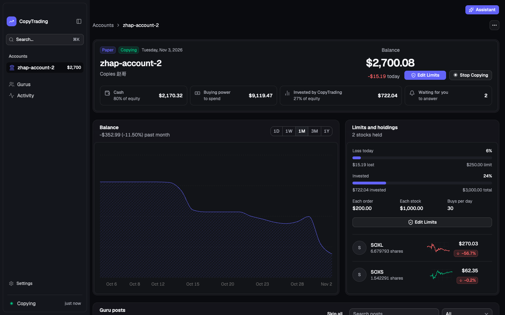
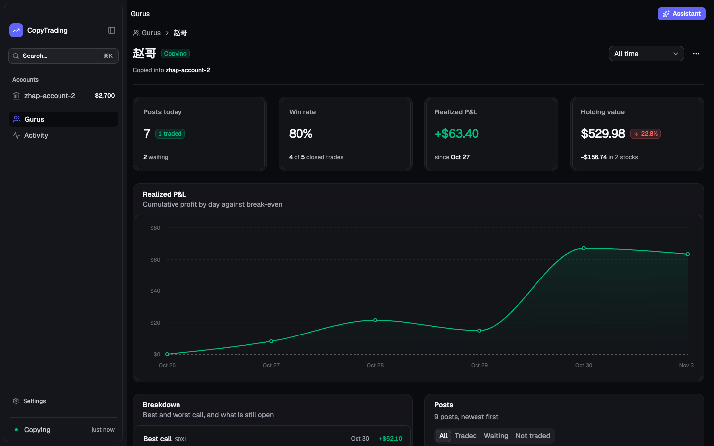
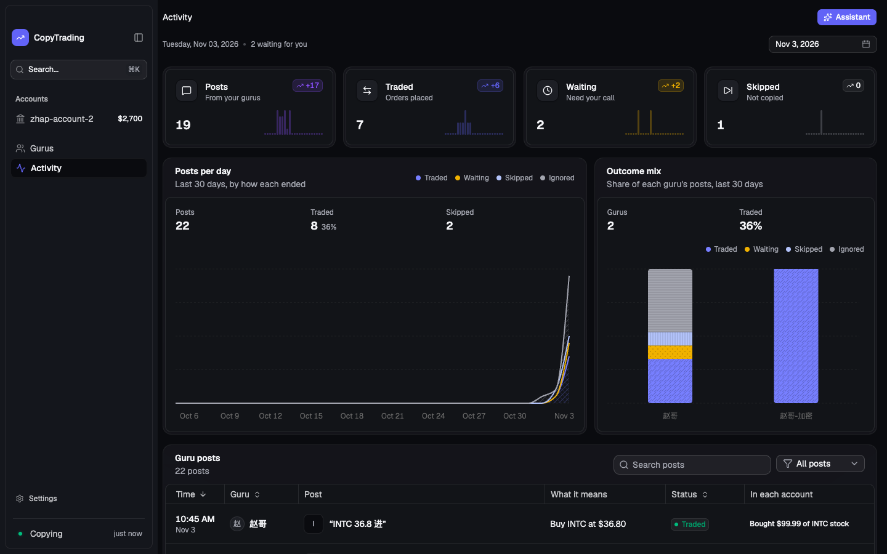
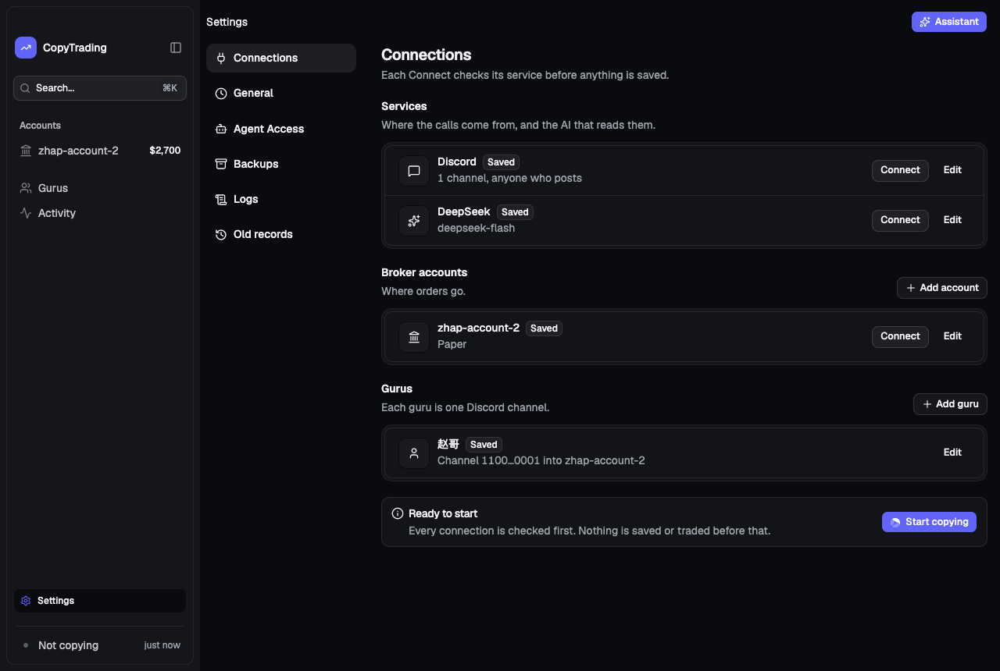
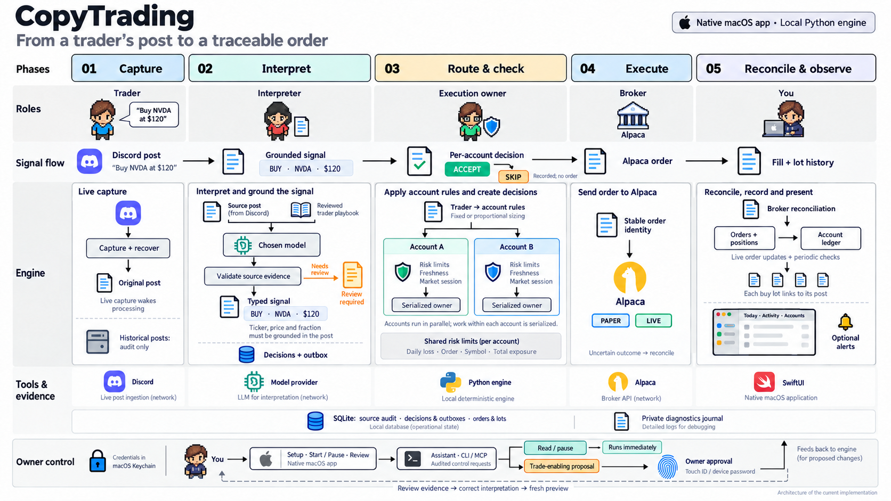

<p align="center">
  
</p>

<h1 align="center">CopyTrading</h1>

<p align="center">
  <em>Copy the traders you trust, inside limits you set.</em>
</p>

<p align="center">
  <a href="https://github.com/YZXBiz/copytrading/actions/workflows/ci.yml?query=branch%3Amain"></a>
  <a href="https://coverage-badge.samuelcolvin.workers.dev/redirect/YZXBiz/copytrading"></a>
  <a href="https://github.com/YZXBiz/copytrading/releases"></a>
  
  <a href="LICENSE"></a>
</p>

<p align="center">
  <a href="https://github.com/YZXBiz/copytrading/releases/download/v0.1.0-beta.8/CopyTrading-0.1.0-beta.8.dmg"></a>
</p>

<p align="center">
  <strong>Not financial advice.</strong> CopyTrading is software, not an adviser. Trading can lose money, and you are responsible for every order it places.
</p>

CopyTrading is a macOS app that reads the stock calls traders post on Discord, turns each one into an exact order, checks it against your limits, and places it with your Alpaca account. Everything runs on your Mac.

> [!WARNING]
> **Not financial advice.** Nothing in this project, including the app, its assistant, and the traders it copies, is investment, financial, legal, or tax advice, and nobody here recommends any trade. Trading can lose some or all of your money. You alone choose whom to copy and what limits to set, and you are responsible for every order placed in your accounts. The software is provided as is, without warranty ([MIT license](LICENSE)).
>
> **Developer preview.** CopyTrading has not been qualified for live trading. Start with an Alpaca paper account, and see [validation](docs/validation.md) for what has and has not been proven.

<p align="center">
  <a href="docs/assets/account.png"></a>
</p>

<details>
<summary>More screenshots</summary>
<br>
<table>
  <tr>
    <td width="33%"><a href="docs/assets/guru.png"></a></td>
    <td width="33%"><a href="docs/assets/activity.png"></a></td>
    <td width="33%"><a href="docs/assets/connections.png"></a></td>
  </tr>
  <tr>
    <td align="center"><sub><b>A guru</b>: what copying them has made</sub></td>
    <td align="center"><sub><b>Activity</b>: every post and what came of it</sub></td>
    <td align="center"><sub><b>Connections</b>: set up top to bottom</sub></td>
  </tr>
</table>
</details>

## Features

- **Posts become exact orders.** A model you choose reads each post, and every ticker, price, and fraction must appear in the post itself, so it cannot invent a number.
- **Your limits, per account.** Daily loss, per-order, per-symbol, and total exposure limits are checked before every copied buy. Each account has its own **Start Copying** and **Stop Copying**.
- **Many traders, many accounts.** Each account follows one guru and sizes its calls from that guru's full position, so several gurus copy side by side into their own accounts, paper and live together.
- **Every position traces to its post.** Each copied buy is kept as a lot that names the post behind it, and you can sell any lot on its own. Shares you trade yourself in Alpaca are counted as yours on the next sync.
- **See how a guru is doing.** Each guru's page shows the realized profit of the trades copied from them, their win rate, and their best and worst call.
- **Always live.** Balances, positions, and the balance chart are read from your broker even while copying is paused, held prices update every few seconds, and a fill arrives as a notice in the app. The menu bar shows your balance and today's change.
- **Calls that need you, in one place.** A call the app should not place on its own (a suggestion, a conditional order, a sell of a buy it never made) waits on the account page with **Copy** and **Skip**, or **Skip all**.
- **Fast to get around.** ⌘K finds any page, account, guru, post, or action; ⌘1 to ⌘4 open Accounts, Gurus, Activity, and Connections; ⌘, opens Settings. Dark and light themes.
- **An assistant that cannot trade on its own.** ⌘J answers from your real posts and accounts. Anything that could place an order waits for your approval in the app.
- **Private by design.** Keys are encrypted on your Mac with a key kept in your login Keychain and never shown on screen. The app talks to Discord, your model provider, your broker, GitHub when it checks for updates, and a logo service that is sent only the tickers you hold.

Works with a dozen hosted model services, local models through Ollama, or any OpenAI-compatible address.

## Install

You need an Apple silicon Mac running macOS 26 or later.

1. **[Download CopyTrading for macOS](https://github.com/YZXBiz/copytrading/releases/download/v0.1.0-beta.8/CopyTrading-0.1.0-beta.8.dmg)**.
2. Open the DMG and drag **CopyTrading** into **Applications**.
3. Open CopyTrading. Preview builds are not yet notarized by Apple, so the first time macOS blocks it: go to **System Settings → Privacy & Security** and choose **Open Anyway**. You only do this once.

Every release lists SHA-256 checksums, and [releases](docs/releases.md) explains how to verify a download.

**Coming from an earlier version?** 0.1.0-beta.7 offers this version as an update. On its first launch the new app copies your saved keys from the old app once, so macOS asks whether CopyTrading may read them; choose **Always Allow**. Your setup, accounts, and history carry over unchanged, and copying picks up where it was.

**Updates.** The app checks GitHub for a new version after launch and every six hours, and **Check for Updates…** in the app menu checks at once. Preview builds are not signed with a lasting identity, so macOS will not let an installed copy replace itself: the app tells you when a version is out and opens its release page, and the new DMG replaces the app in Applications.

**Or build from source** with [uv](https://docs.astral.sh/uv/), Node.js, and the Xcode Command Line Tools:

```sh
git clone https://github.com/YZXBiz/copytrading.git
cd copytrading
make app
```

`make app` checks your Mac, downloads a pinned and checksummed runtime, builds the app, and opens it. The first build takes a few minutes.

## Get started

A first launch opens on **Getting Started**, a short checklist that leads to each next step. Nothing is saved or traded until you press **Start Copying**.

Everything is set up in **Settings → Connections**, top to bottom:

1. **Discord**: the channels to read and your Discord token.
2. **Interpreter**: the model that reads posts, and its API key.
3. **Broker accounts**: an Alpaca **paper** account.
4. **Gurus**: choose the account each guru copies into (its max per stock is the guru's full position), press **Learn from Channel**, and review the playbook it drafts.
5. Press **Start Copying**. It checks every connection first, and starts only when they all pass.

Every field that needs a key or an ID has a **Where do I find this?** link. Once setup is done, the sidebar keeps to what you use every day: your accounts, your gurus, and Activity.

## How it works

<p align="center">
  <a href="docs/assets/copytrading-workflow.png"></a>
  <br>
  <sub><a href="docs/assets/copytrading-workflow.png">View the full-resolution diagram</a></sub>
</p>

A desktop app (Electron and React) supervises one local Python engine. The engine owns every decision, keeps it in SQLite, and reconciles with the broker after a crash or sleep, so a signal that expires while the app is closed never becomes a late order. Every action that moves money asks in a native macOS dialog that says exactly what will happen. [Architecture](docs/architecture.md) has the details and the [ADRs](docs/adr/) record why.

## Command line and agents

The `copytrading` CLI and MCP server let you, a script, or a coding agent read the running app and pause it, and the CLI sets it up. Anything that could trade becomes a proposal you approve in the app. `copytrading accounts limits ACCOUNT --max-order-usd 300 …` changes an account's limits and `copytrading start` starts copying with Start Copying's own checks; both wait for your approval in the app. Turn it on in **Settings → Agent Access**, then put a small launcher for the command that ships inside the app on your `PATH`:

```sh
mkdir -p ~/.local/bin
cat > ~/.local/bin/copytrading <<'EOF'
#!/bin/sh
app=/Applications/CopyTrading.app/Contents/Resources
PYTHONPATH="$app/Engine/src" exec "$app/Runtime/cpython/python/bin/python3" -m copytrading_engine.control "$@"
EOF
chmod +x ~/.local/bin/copytrading
```

```console
$ copytrading status
Engine      running
Copying     Copying
Source      connected
Model       ready
Queued      0 messages, 0 signals
Account     primary  Copying, after a restart automatic

$ copytrading accounts limits primary --max-order-usd 300
Waiting for approval in CopyTrading: change primary: max order usd = 300. Proposal p-4e1a9c07d2b3, expires 2026-10-14 16:42:00.

$ copytrading start
Waiting for approval in CopyTrading: start copying. Proposal p-81f0c6a95e24, expires 2026-10-14 16:43:10.
```

`copytrading setup` sets everything up without the window: Discord, the model, Alpaca accounts with their keys and limits, gurus, and alerts. Edits go into the same unsaved setup Connections shows. `setup apply` runs Start Copying's checks and saves; copying that runs picks up the change, and copying you paused stays paused. `setup apply --start` also starts copying, so a first setup needs no window. Keys are read only from standard input or a file and are never printed. To use it, choose **Read, pause, and ask for approval** in Agent Access and turn on **Allow setup changes from the command line** there (off by default). A paper setup applies directly; making an account live, saving keys for one, or starting copying into one waits for your approval in the app.

```console
$ copytrading setup discord --channels 1517000000000009742 --secret-stdin < discord-token.txt
$ copytrading setup model --service deepseek --model deepseek-flash --from-file deepseek-key.txt
$ copytrading setup account add paper-2 --from-file alpaca-paper-2.txt --max-order-usd 250  # key ID, then secret
$ copytrading setup guru add Alex --account paper-2 --full-position 600
$ copytrading setup apply --start
Applied: the setup is saved, and copying uses it.
Saved, and copying started.
  ok      discord
  ok      model
  ok      paper-2
```

See [agent control](docs/agent-control.md) for the commands, permission tiers, and threat model.

The engine also runs without the app, on a Mac or a Linux server, so copying continues while your Mac sleeps. `copytrading-server` reads a `copytrading.toml` file and keys from environment variables, and a Docker image is included. See [Run the engine without the app](docs/server.md).

## Documentation

| | |
| --- | --- |
| [PRD](docs/PRD.md) | Who CopyTrading is for and what it must do |
| [Architecture](docs/architecture.md) · [Engine structure](docs/engine-structure.md) · [ADRs](docs/adr/) | How the pieces fit, and why |
| [Desktop app](desktop/README.md) | How the app is built: screens, engine reads and actions, fixtures, captures |
| [Agent control](docs/agent-control.md) · [Server](docs/server.md) | The `copytrading` CLI and MCP server, and running the engine without the app |
| [Acceptance](docs/acceptance.md) · [Validation](docs/validation.md) | What "working" means, and the evidence so far |
| [Operations](docs/operations.md) · [Releases](docs/releases.md) | Developer commands and preview builds |
| [Changelog](CHANGELOG.md) | What changed in each release |

## Contributing

Run `make doctor` to check your Mac, then `make check` for the engine's 2,000+ tests, Ruff, and Ty, and `npm test` in `desktop/` for the app's 600+ tests. [CONTRIBUTING.md](CONTRIBUTING.md) covers the conventions. Ask questions in [Discussions](https://github.com/YZXBiz/copytrading/discussions), report bugs with the [issue forms](https://github.com/YZXBiz/copytrading/issues/new/choose), and report vulnerabilities privately as described in [SECURITY.md](SECURITY.md).

## License

[MIT](LICENSE)
